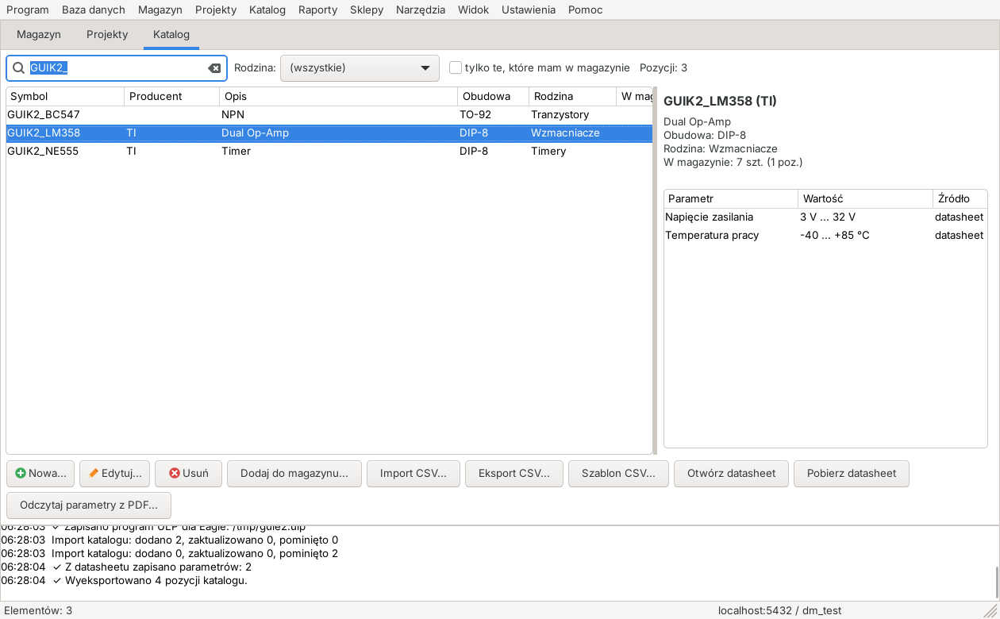
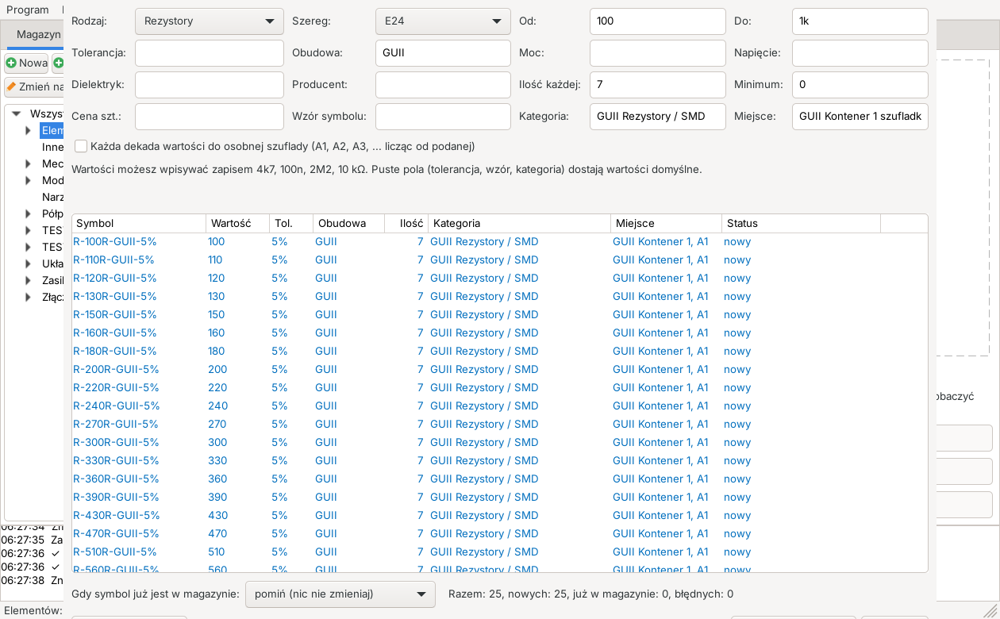
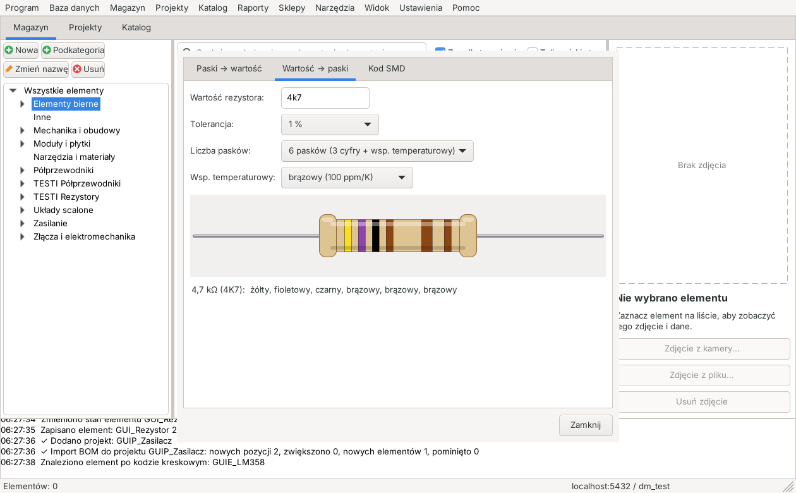

# Magazyn Elektroniki

Program do prowadzenia domowego magazynu części elektronicznych: rezystorów, kondensatorów, układów scalonych, złączy i całej reszty, która ląduje w szufladkach. Wiesz, co masz, gdzie to leży, ile zostało i czego brakuje do projektu.

Napisany w C++17 z wxWidgets, dane trzyma w PostgreSQL. Działa na Windows, macOS i Linuksie, interfejs jest po polsku.



## Co potrafi

**Magazyn**
- Drzewo kategorii i podkategorii, elementy z symbolem, producentem, wartością, tolerancją, obudową, ceną i zdjęciem.
- Miejsce magazynowania (np. *Kontener 1 / szufladka A1 / przegroda 2*), stan minimalny z kolorowym ostrzeżeniem, historia przyjęć i wydań.
- Kody kreskowe EAN i wydruk etykiet; odczyt kodu ze zdjęcia z kamery USB (opcjonalnie, OpenCV).
- Szybkie wyszukiwanie po symbolu, opisie, producencie, obudowie i tagach.

**Hurtowe dodawanie**
- Generator szeregów E12, E24, E48 i E96 dla rezystorów, kondensatorów i cewek, z własnym wzorem symbolu i kolejnymi szufladkami.
- Import elementów z CSV (nagłówki po polsku lub angielsku, separator wykrywany automatycznie).



**Projekty**
- Import listy części (BOM) z KiCada i Eagle'a, dopasowanie do magazynu, lista zakupów do CSV, wydawanie części z magazynu na projekt.

**Katalog elementów**
- Osobna baza typów elementów (np. LM358, BC547) z parametrami, powiązana z magazynem po symbolu.
- Pobieranie datasheetów i odczyt parametrów z PDF: tabele *Absolute Maximum Ratings* i *Electrical Characteristics*, hFE tranzystorów i opis zastosowania. To heurystyka, więc program tylko proponuje, a Ty zatwierdzasz.

**Sklepy i ceny**
- Lista sklepów, sprawdzanie cen na stronach produktów, historia cen, najtańsze zestawienie zakupów.

**Narzędzia**
- Paski kolorów rezystorów (3 do 6 pasków) w obie strony, kody SMD (3 i 4 cyfry, EIA-96, kondensatory).
- Kalkulatory: dzielnik napięcia, rezystor do diody LED, filtr RC.



**Eagle CAD 7.6**
- Skrypt `.scr` ustawiający atrybuty części oraz program ULP, który zapisuje listę części do CSV czytanego przez import projektu.

**Inne**
- Pomoc w oknie programu (F1, opisy pól w dymkach), raporty, kopie zapasowe, sprawdzanie aktualizacji (menu Pomoc).

## Pobieranie

Gotowe instalatory (DEB dla Debiana i Ubuntu, instalator i wersja przenośna dla Windows, DMG dla macOS) znajdziesz w zakładce **Releases**. Program potrzebuje działającego serwera PostgreSQL, który może być na tym samym albo innym komputerze.

## Wymagania

| | |
|---|---|
| Kompilator | C++17 (GCC, Clang, MinGW) |
| Budowanie | CMake 3.16 lub nowszy |
| Biblioteki | wxWidgets 3.2, libpq (PostgreSQL) |
| Baza danych | PostgreSQL 9.6 lub nowszy z rozszerzeniem `ltree` |
| Opcjonalnie | OpenCV (moduły `core` i `videoio`, kamera USB), poppler (`pdftotext`, odczyt datasheetów), gettext (tłumaczenia) |

## Budowanie

**Linux (Debian, Ubuntu)**
```bash
sudo apt install cmake g++ libwxgtk3.2-dev libpq-dev poppler-utils libopencv-dev
cmake -S . -B build -DCMAKE_BUILD_TYPE=Release
cmake --build build -j
./build/DomowyMagazyn
```
Pakiet DEB: `narzedzia/zbuduj_deb.sh`.

**Windows (MSYS2, powłoka MINGW64)**
```bash
pacman -S --needed mingw-w64-x86_64-toolchain mingw-w64-x86_64-cmake mingw-w64-x86_64-ninja \
  mingw-w64-x86_64-wxwidgets3.2-msw mingw-w64-x86_64-postgresql
cmake -S . -B build -G Ninja -DCMAKE_BUILD_TYPE=Release
cmake --build build
```
Instalator i wersja przenośna: `narzedzia/zbuduj_windows.sh`.

**macOS**
```bash
brew install cmake wxwidgets postgresql@15 dylibbundler poppler    # albo odpowiedniki z MacPorts
cmake -S . -B build-mac -DCMAKE_BUILD_TYPE=Release -DUSE_SYSTEM_WX=ON
cmake --build build-mac -j
```
Aplikacja `.app` i obraz `.dmg`: `narzedzia/zbuduj_macos.sh`. Szczegóły i uwagi o MacPorts: [dokumentacja/instalacja.md](dokumentacja/instalacja.md).

## Pierwsze uruchomienie

1. Uruchom program i wpisz dane połączenia: **Baza danych → Ustawienia połączenia**.
2. Na pustej bazie wybierz **Baza danych → Utwórz / zaktualizuj strukturę bazy**. Skrypty z katalogu `sql/` można uruchamiać wielokrotnie, nie kasują danych.
3. Rozszerzenie `ltree` musi być dostępne. Jeśli użytkownik aplikacji nie może go utworzyć, administrator wykonuje jednorazowo `CREATE EXTENSION IF NOT EXISTS ltree;`.
4. Opcjonalnie zaimportuj kategorie startowe: **Magazyn → Importuj kategorie startowe**.

Konfiguracja (`config.ini`) zawiera dane dostępu do bazy, razem z hasłem zapisanym zwykłym tekstem, jeśli pozwolisz programowi je zapamiętać. Ten plik nie należy do repozytorium.

## Testy

Testy działają na osobnej, pustej bazie (kasują schemat `public`!):

```bash
cmake -S . -B build -DDM_BUILD_TESTS=ON
cmake --build build -j
DM_TEST_DB=dm_test DM_TEST_USER=postgres DM_TEST_PASSWORD=... ctest --test-dir build --output-on-failure
```
Testy okien (`test_gui`, `test_siec`) buduje się osobno (`make test_gui`) i wymagają wyświetlacza, np. `xvfb-run`.

## Dokumentacja

- [Instrukcja użytkownika](dokumentacja/instrukcja_uzytkownika.md)
- [Budowanie i instalacja](dokumentacja/instalacja.md)
- [Struktura bazy danych](dokumentacja/struktura_bazy.md)
- [Lista zadań i pomysłów](DoZrobienia.txt)

## Układ katalogów

```
src/        kod: BazaDanych, Logika, GUI, Import, Eksport, Wyszukiwanie, Narzedzia, Pomoc
sql/        schemat bazy, funkcje, widoki, dane startowe
pomoc/      źródło pomocy HTML i opisy pól
narzedzia/  skrypty budujące (DEB, Windows, macOS, ikony, pomoc)
tests/      testy
lang/       tłumaczenia
```

## Sprawdzanie aktualizacji

Program porównuje swoją wersję z plikiem [`wersja.txt`](wersja.txt) w tym repozytorium. Niczego sam nie instaluje, tylko podaje link do pobrania.
